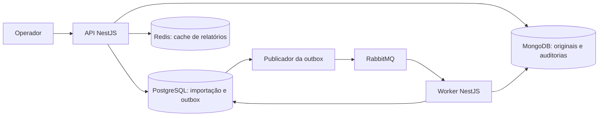

# CatalogGate

**Auditoria assíncrona de catálogos de fornecedores.** Envie um lote, receba um protocolo e consulte quais itens passam na validação, quais foram rejeitados e o dado original que explica cada rejeição.

## Demonstração

Com Docker e Docker Compose, na raiz do repositório:

```sh
docker compose up -d --build --wait
docker compose run --rm --no-deps --build checks npm run demo
```

A demo envia dois lotes fictícios, aguarda o worker e confere os resultados antes de exibi-los:

| Fornecedor | Formato                                          | Itens aceitos |                                    Itens rejeitados |
| ---------- | ------------------------------------------------ | ------------: | --------------------------------------------------: |
| Northwind  | Plano (`sku`, `stock`)                           |             1 | 3: estoque negativo e duas linhas com SKU duplicado |
| Trailforge | Aninhado (`product.code`, `inventory.available`) |             1 |                                     1: SKU inválido |

Em cada rejeição, a demo imprime a linha, os códigos e o item original. As fixtures estão em [`fixtures/`](fixtures/). A API fica em `http://127.0.0.1:3180` e pode ser usada sem frontend:

```sh
curl -i http://127.0.0.1:3180/imports \
  -H 'Content-Type: application/json' \
  -H 'Idempotency-Key: 9d9699c0-d2e6-4b1e-b013-6f3a2faf14af' \
  --data-binary @fixtures/northwind.json
```

| Rota                      | Resultado                                                                                                        |
| ------------------------- | ---------------------------------------------------------------------------------------------------------------- |
| `POST /imports`           | `202 Accepted` com o protocolo e o header `Location`. Mesma chave e mesmo lote devolvem o mesmo protocolo.       |
| `GET /imports/:id`        | Estado `pending`, `completed` ou `failed`. Um lote pode estar concluído mesmo que contenha rejeições de negócio. |
| `GET /imports/:id/report` | Relatório concluído ou `409 REPORT_NOT_AVAILABLE`.                                                               |
| `GET /health`             | Verifica se a API responde; não é uma inspeção das dependências.                                                 |

Consulte o [contrato OpenAPI](docs/openapi.yaml) para exemplos, limites e códigos de resposta.

## Arquitetura



- **PostgreSQL:** transação única registra a importação e o evento pendente. Uma restrição única por fornecedor e chave resolve chamadas concorrentes. O estado e os totais oficiais também ficam no PostgreSQL.
- **RabbitMQ:** transporta apenas o identificador da importação. O publicador só marca o evento como enviado após confirmação; o consumidor só confirma sucesso após gravar o resultado.
- **MongoDB:** guarda uma auditoria por importação, com o original e os detalhes da validação. A gravação por identidade não substitui um resultado já registrado.
- **Redis:** cache de relatórios concluídos por cinco minutos. Se estiver indisponível, a API consulta as fontes duráveis.

A regra de auditoria não importa NestJS, banco ou broker. O módulo `imports` separa domínio, casos de uso, transporte HTTP e adaptadores. A composição do NestJS liga essas partes. Veja [decisões e limites](docs/architecture.md).

## Validação

Sem exigir Node.js no host, rode os testes dentro do Compose:

```sh
docker compose run --rm --no-deps --build checks sh -c 'npm run lint && npm run typecheck && npm test'
docker compose run --rm --no-deps checks
```

O segundo comando roda testes HTTP com PostgreSQL, MongoDB, RabbitMQ e Redis reais. A suíte cobre os dois formatos, idempotência concorrente, entrega repetida, fila de mensagens rejeitadas, cache e entradas inválidas.

A [CI](.github/workflows/ci.yml) também executa testes que **param e religam** RabbitMQ e Redis em um projeto Compose descartável. Para repetir esse teste localmente, encerre antes a stack padrão (ambas usam a porta 3180), use Node.js 24+ no host e execute:

```sh
docker compose down
docker compose -p cataloggate-qa up -d --build --wait
env CATALOGGATE_TEST_PROJECT=cataloggate-qa npm run test:resilience
docker compose -p cataloggate-qa down
```

Use `down --volumes` apenas se quiser apagar os dados do projeto Compose especificado. A stack padrão é uma demonstração local, sem autenticação: só a API é publicada, em loopback. Use dados fictícios.
